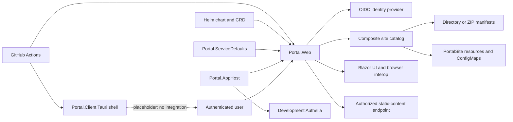

# High-Level Design: Portal

## Problem

People need a single authenticated entry point to discover and open the web
services available to them. Administrators need to describe those services
without rebuilding the portal, and deployments need both directory/ZIP and
Kubernetes-backed catalog sources. The repository also contains a native
desktop/mobile shell, but it does not yet connect to the portal.

This description is reconstructed from the repository's README, application
composition, providers, chart, and client. It records current behavior, not a
new product commitment.

## Approach

Portal is an authenticated Blazor Interactive Server application. It composes
site metadata from file-backed sources and Kubernetes `PortalSite` resources,
then renders role- and browser-aware site discovery and launch experiences.
Static content is served by authenticated endpoints. Aspire supplies a local
development topology; shared service defaults supply observability,
service-discovery, resilience, and health-check configuration. A Helm chart
packages the server for Kubernetes. GitHub Actions validates and publishes
server and native-client artifacts.

**Owner-approved catalog scope:** The web Kubernetes provider discovers
PortalSite resources across all namespaces. ConfigMap content stays in the
referencing resource's namespace; Helm supplies cluster-wide read permissions.

The Tauri client is currently a placeholder shell. Its integration with the
portal, authentication, and catalog is not implemented.

The owner-approved release policy separates development builds from stable versions:
pushes to `main` publish mutable `dev` artifacts, while stable releases are
created from `vMAJOR.MINOR.PATCH` tags using the corresponding MinVer version.
The stable container channel owns `latest` and floating major/minor tags.

**[planned]** The client manifest contract and schema metadata belong to
issue #6. Issue #7 will expose the manifest and use ASP.NET Core's built-in
OpenAPI support in development only, without adding a Swagger or Scalar UI.

## Target Users

- **Portal users** need to find and open the sites available to their identity,
  browser, and device.
- **Portal operators** configure OIDC, site manifests or Kubernetes resources,
  and deployment settings.
- **Portal developers** run the local Aspire topology and verify server and
  native-client changes across the supported CI targets.

These user roles are inferred from the implemented interfaces and setup
documentation.

## Goals

- Require authentication for the portal and its protected content endpoints.
- Present a catalog whose site details can be supplied without changing
  application code.
- Apply role checks to site visibility and static-content requests.
- Support local development through the documented Aspire topology.
- Build, test, package, and publish the server and native shell through the
  repository's documented automation.

These goals summarize existing behavior; they have not been independently
approved as future product requirements.

## Non-Goals

- The current Tauri shell does not implement portal connectivity or
  authentication.
- The repository does not establish a separate deployment or runtime for
  Digital Fortress; no such references were found in the inspected files.
- The mapping does not assert that every current implementation detail is an
  intended invariant. Unexplained or inconsistent behavior is recorded as an
  open question in the relevant design.

## Tenets

The following are inferred from current implementation and documentation and
remain subject to owner confirmation:

- **Keep site metadata external to application code.** File manifests and
  Kubernetes resources provide catalog entries.
- **Enforce identity at server boundaries.** UI filtering is complemented by
  authorization on protected endpoints.
- **Make local and deployed operation use the same portal application.**
  Aspire and Helm configure the same web project for different environments.

## System Design

The diagram describes current repository wiring. The native-client relationship
to the user is limited to its placeholder UI. The chart's CRD and RBAC configure
the Kubernetes source consumed by the server.

The mapped leaf designs are:

1. Identity and access — `docs/intent/identity-and-access/`
2. Site catalog and content sources — `docs/intent/site-catalog/`
3. Portal experience — `docs/intent/portal-experience/`
4. Native client shell — `docs/intent/native-client/`
5. Local runtime and service defaults — `docs/intent/runtime-services/`
6. Kubernetes deployment — `docs/intent/kubernetes-deployment/`
7. Build and delivery — `docs/intent/build-delivery/`

This seven-segment, behavior-oriented breakdown is an agent-selected medium
slicing, authorized by the owner with the instruction to use best choices and
document assumptions. It is not a claim that the owner has reviewed each
boundary.

## Key Design Decisions

| Decision | Current approach | Alternatives considered | Rationale |
|---|---|---|---|
| Catalog composition | File provider precedes Kubernetes provider; first matching site ID wins. **[inferred]** | Kubernetes overrides files; merge duplicate sites; reject duplicates across sources. | This is directly observable in provider registration and composition (`Portal.Web/Program.cs:89`, `Portal.Web/Services/CompositePortalProvider.cs:10-45`). The desired override policy is unconfirmed. |
| Identity integration | OIDC authorization code flow with PKCE and `groups` as role claims. **[inferred]** | Anonymous portal; different identity protocol or claim mapping. | Application configuration and local Authelia configuration establish this behavior (`Portal.Web/Program.cs`, `Portal.AppHost/Authelia/configuration.yml`). |
| Client scope | Tauri remains a placeholder rather than a second portal implementation. **[inferred from README]** | Implement portal integration and authentication in the client. | README explicitly says integration is not implemented. Future client intent is open. |
| Deployment packaging | Helm deploys the existing web container and its Kubernetes permissions. **[inferred]** | External deployment-only configuration or a separate operator. | The chart defines the deployment, service, service account, RBAC, and CRD. The operational boundaries beyond this chart are not established. |
| Release channels | **Owner-approved design:** main publishes rolling `dev` artifacts; stable `vMAJOR.MINOR.PATCH` tags publish MinVer-versioned releases. Stable container tags also advance `latest`, `MAJOR.MINOR`, and `MAJOR`. | Publish every main build as `latest`; retain a separate release for every main commit. | Keep deployments pinned to a chart/image version while preserving an explicit development channel. Detailed behavior is in `docs/intent/build-delivery/build-delivery-design.md`. |

## Success Metrics

The repository does not define product-level success metrics. Observable
verification signals are:

- Server tests pass and `dotnet build Portal.slnx` succeeds.
- Portal frontend typecheck and production bundle build succeed as part of the
  web project build.
- Helm lint and container packaging validation succeed in CI.
- Client CI builds and smoke-tests the configured desktop and Android targets.

These are engineering checks, not measures of portal adoption or user
satisfaction.

## Open Questions

- Should `IsPrivate` and `IsInternal` affect direct content endpoint access, or
  are they intentionally presentation-only flags?
  For the client manifest, the owner decided (2026-11-27) that they
  are client metadata and the server filters by roles only; see the
  identity-and-access LLD.
- Is file-over-Kubernetes precedence a product invariant?
- Are the development-only Authelia credentials and client secret isolated
  from all non-development deployments?
- Should production deployments use persistent/shared data-protection keys,
  probes, resource limits, or more than one replica?
- What should the Tauri client do when portal integration is designed?
- The existing `AGENTS.md` states .NET 10 and says there are no test projects;
  project files instead target .NET 11 and include `Portal.Web.Tests`. The
  repository's instructions and actual project state disagree.

## References

- Repository overview and operational documentation: `README.md`
- Application composition: `Portal.Web/Program.cs`
- Local topology: `Portal.AppHost/AppHost.cs`
- Shared runtime defaults: `Portal.ServiceDefaults/Extensions.cs`
- Kubernetes deployment: `chart/`
- Native-client state: `Portal.Client/`
- LID navigation: `docs/arrows/index.yaml`
